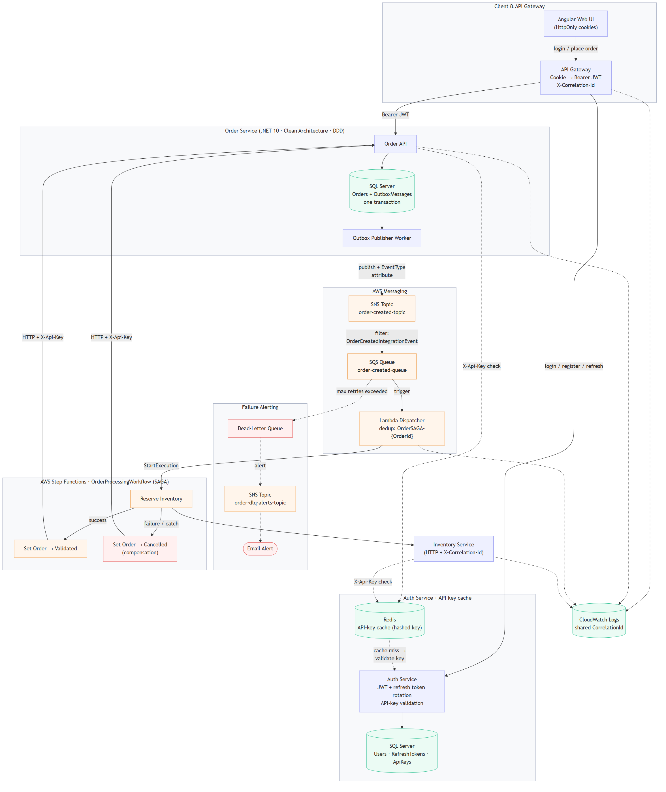
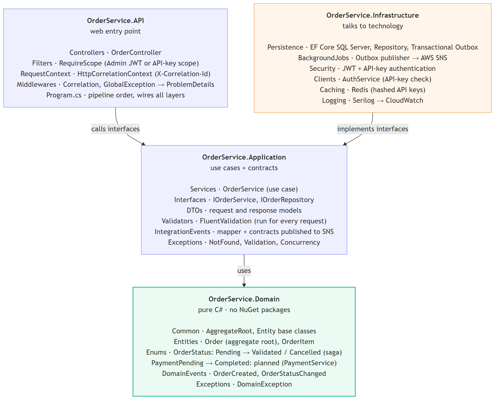
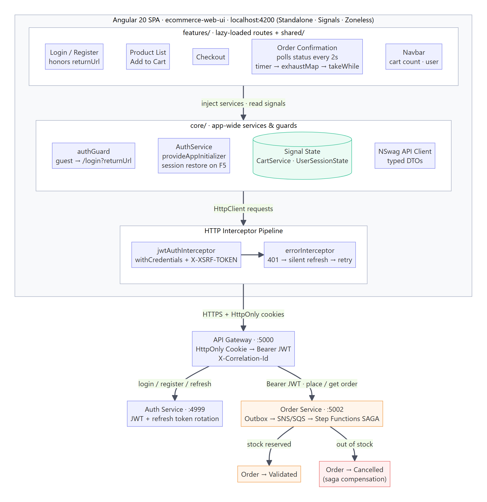

# 🛒 Enterprise E-Commerce Microservices & AWS Saga Showcase

Welcome to the **Enterprise E-Commerce Microservices Architecture Showcase**. This repository presents the complete architectural blueprint, design patterns, cloud-native event-driven pipelines, and distributed tracing implementation for a production-grade e-commerce microservices platform.

---

## 🎯 Scope & Focus

This showcase deliberately concentrates on three areas:

1. **OrderService:** the reference implementation (Rich Domain Model, Aggregate Root, Transactional Outbox, FluentValidation, ApiKey + JWT auth).
2. **AWS Saga:** SNS, SQS, Lambda and Step Functions orchestration, including compensation.
3. **Frontend:** the Angular app (interceptors, guards, saga status polling).

**ApiGateway**, **AuthService** and **InventoryService** are supporting services, shown with only a few highlights each. They follow the same Clean Architecture but are intentionally lighter.

**Next:** see `architecture/next-phase-architecture.md`.

---

## 🏗️ System Architecture

### System Topology



- **Angular** talks only to the **API Gateway** (BFF). Tokens stay in HttpOnly cookies; the Gateway turns the cookie into a `Bearer` JWT and adds an `X-Correlation-Id` for every downstream call.
- **AuthService** issues the JWT and refresh tokens. OrderService and InventoryService check the saga's `X-Api-Key` in **Redis** first and ask AuthService only on a cache miss.
- **OrderService** saves the order and an outbox message in **one transaction**. A background worker publishes the event to **SNS → SQS → Lambda → Step Functions**.
- The **saga** reserves stock in **InventoryService** (`X-Api-Key`) and sets the order to `Validated`, or to `Cancelled` as compensation when the reservation fails.
- Logs from the Gateway, OrderService, the Lambda and InventoryService share **one CorrelationId** in CloudWatch.

Full walkthrough: [system-architecture-flow.md](architecture/system-architecture-flow.md)

### OrderService · Clean Architecture



- Four projects; arrows are the real project references, and all of them point inwards.
- **Domain** is pure C# (no NuGet packages): the business rules live in the `Order` aggregate.
- **Application** holds the use cases and the interfaces; **Infrastructure** implements them (EF Core, SNS, Redis, CloudWatch); **API** holds only web code.

### Frontend · Angular 20



- Standalone components, Signals and zoneless change detection; features are lazy-loaded.
- Interceptors send the cookies (`withCredentials`), add the XSRF header, and refresh an expired session silently on `401`.
- The order confirmation page polls the order status until the saga has finished.

---

## 📸 Code Highlights

Screenshots of the most interesting code, one folder per part:

| Folder | What it shows |
|---|---|
| [OrderService](src/OrderService/) | Aggregate root, factory method, domain events, transactional outbox, API-key auth, global exception handling, use case, unit tests |
| [ApiGateway](src/ApiGateway/) | JWT validation with cookie fallback, typed HttpClients + forwarding handlers |
| [AuthService](src/AuthService/) | Login with hashed refresh token, refresh-token rotation + reuse detection |
| [InventoryService](src/InventoryService/) | Secured reserve endpoint, idempotent stock reservation |
| [Frontend](src/Frontend/) | App screens, interceptors, guard, saga status polling |
| [AWS](aws/) | Lambda dispatcher, Step Functions saga + compensation, CloudWatch trace |

---

## 📂 Repository Layout

Below is the directory structure of this repository, organized by architecture docs and diagrams, code screenshots per service, and AWS screenshots:

```text
ecommerce-demo/
│
├── README.md                           # Overview, scope, tech stack
│
├── architecture/
│   ├── system-architecture-flow.md     # End-to-end request flow, auth, outbox, saga, tracing
│   ├── next-phase-architecture.md      # Planned enhancements
│   └── diagrams/
│       ├── system-topology.png                  # Whole system: Gateway, Order, AWS saga, Inventory
│       ├── orderservice-clean-architecture.png  # OrderService layers + project references
│       └── frontend-architecture.png            # Angular app structure + interceptors
│
├── src/                                # Code screenshots per service
│   ├── OrderService/                   # Domain model, outbox, auth, exceptions, use case, tests
│   ├── ApiGateway/                     # JWT + cookie fallback, typed HttpClients + handlers
│   ├── AuthService/                    # Login + refresh-token rotation
│   ├── InventoryService/               # Reserve endpoint + idempotent reservation
│   └── Frontend/                       # App screens + interceptors, guard, polling
│
└── aws/                                # Lambda dispatcher, Step Functions saga, CloudWatch logs
```

---

## 🛠️ Technology Stack Summary

- **Frontend:** Angular 20 (HTTP Interceptors, Session Restore)
- **API Gateway (BFF):** .NET 10 Web API with typed HttpClients + DelegatingHandlers (cookie → Bearer JWT, X-Correlation-Id)
- **Microservices:** .NET 10 Clean Architecture (`Domain`, `Application`, `Infrastructure`, `API`)
- **Database & ORM:** SQL Server + Entity Framework Core (Transactional Outbox Pattern)
- **Messaging & Serverless Saga:** AWS SNS, AWS SQS, AWS Lambda, AWS Step Functions
- **Security:** Bearer JWT Tokens + Machine-to-Machine `X-Api-Key` Headers
- **Observability:** Serilog Structured Logging + AWS CloudWatch Logs (`X-Correlation-Id` Tracing)


